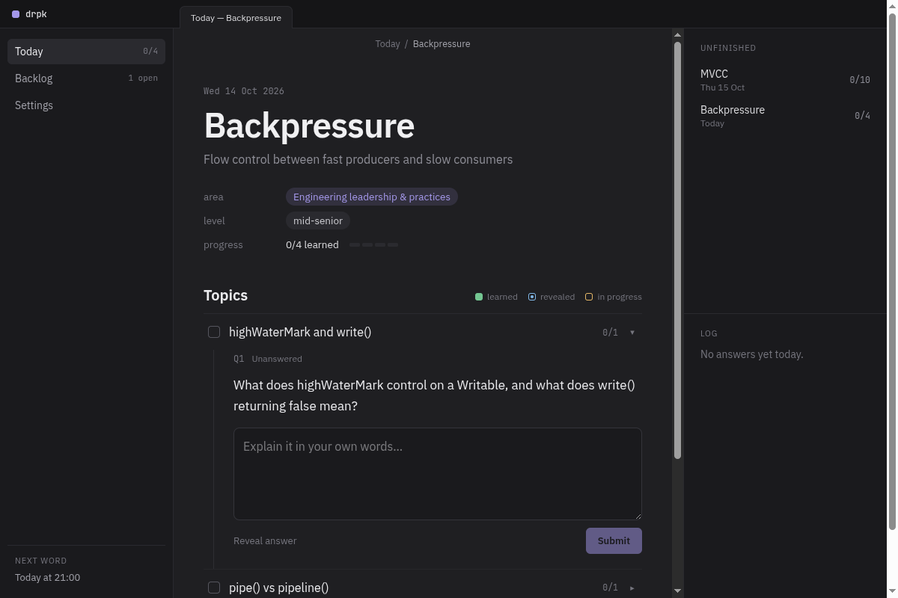
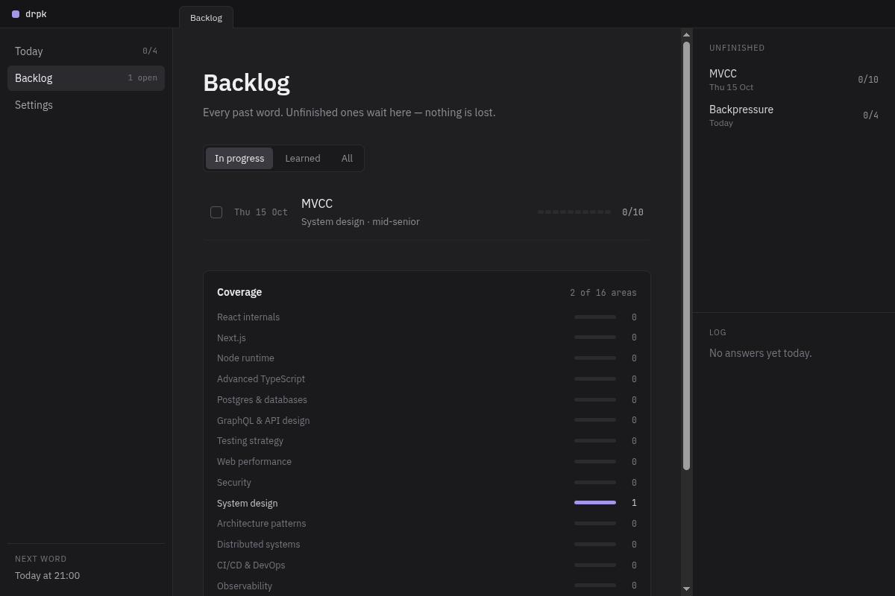
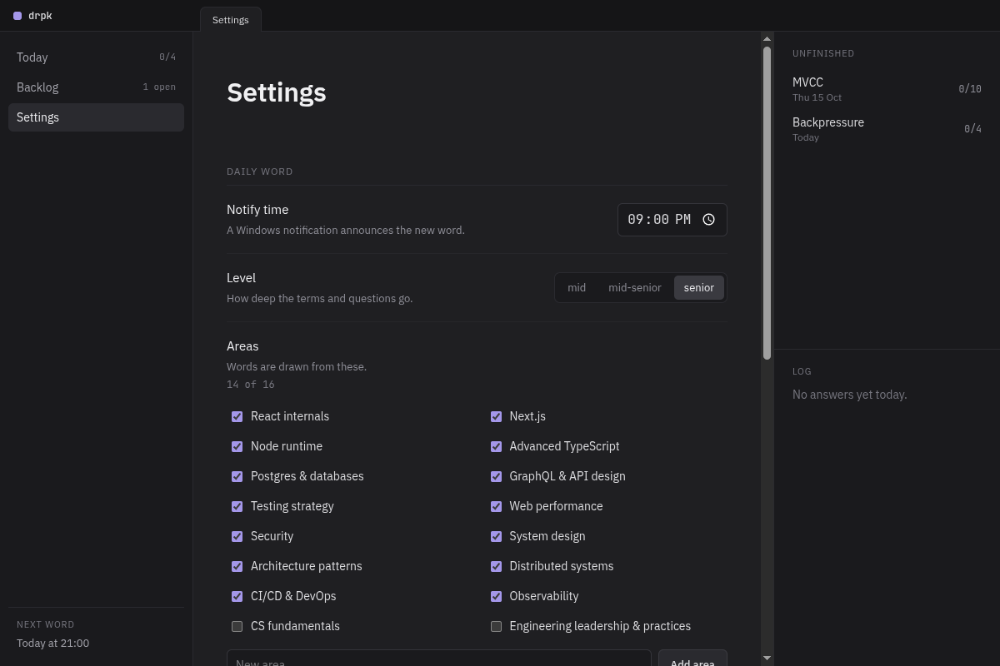

# drpk — Daily Random Programming Knowledge

[](https://github.com/torisutanjon/daily-random-programming-knowledge/actions/workflows/ci.yml)
[](https://github.com/torisutanjon/daily-random-programming-knowledge/releases/latest)

A Windows desktop app that teaches you one programming concept a day. Claude picks a term from the
areas you care about, asks open questions about how it works and its trade-offs, grades your answers
against a rubric, and keeps track of what you have covered.



## What it does

- **One word a day.** At the time you choose, drpk prepares a new word and announces it with a
  Windows notification. Each word comes with 4–8 topics of open questions about mechanisms and
  trade-offs, not definitions.
- **Graded answers.** Write an answer in your own words. Claude grades it against the question's
  rubric as pass, partial or fail. Stuck? Reveal the model answer.
- **Nothing is lost.** Words you don't finish move to the Backlog and wait for you.
- **Coverage.** See how many words you have studied in each of the 16 built-in areas — React
  internals, Node runtime, Postgres, system design, security and more — plus any areas you add.
- **Tuned to you.** Pick a level (mid, mid-senior, senior), the areas to draw from, and your stack,
  so questions fit the tools you use.
- **Try it free.** Without an API key, drpk runs in demo mode with sample words.
- **Starts with Windows**, if you want it to.

| Backlog and coverage | Settings |
|---|---|
|  |  |

## Install

1. Download `drpk Setup <version>.exe` from the [latest release](https://github.com/torisutanjon/daily-random-programming-knowledge/releases/latest).
2. Run it. The installer is not code-signed yet, so Windows SmartScreen will warn you: choose
   **More info → Run anyway**.
3. Open **Settings** and add an [Anthropic API key](https://console.anthropic.com/) to get real
   words. Without one, drpk stays in demo mode.

Installing a new version replaces the old one and keeps your words and settings.

## Privacy and security

- drpk runs entirely on your machine. Its server listens only on `127.0.0.1`; the only outside
  calls are to the Anthropic API, and only when you have added a key.
- Your words, answers and settings are JSON files in the app's data folder. The API key is stored
  there too, in `settings.json`, in plain text — treat that folder as private.
- Pages are served with a strict nonce-based Content Security Policy (no `unsafe-inline`) and
  hardened headers (`X-Frame-Options`, `X-Content-Type-Options`, `Permissions-Policy`,
  cross-origin isolation headers). The app was checked with an OWASP ZAP full active scan.

## How it works

Electron starts Next.js's standalone server in a `utilityProcess` on a free loopback port, then
opens the app window pointed at it. A scheduler in the main process fires at your notify time,
asks the server for the day's word and shows the notification.

| Path | What lives there |
|---|---|
| `app/` | Next.js App Router pages and API routes (`/api/today`, `/api/answer`, `/api/reveal`, …) |
| `components/` | UI components |
| `lib/domain/` | Rules: areas, day boundaries, coverage, question status, settings |
| `lib/llm/` | Claude provider, prompts, and the demo provider |
| `lib/services/` | Today's word and answer grading |
| `lib/store/` | JSON file storage |
| `electron/` | Main process, server launcher, scheduler, launch at login |
| `proxy.ts` | Per-request nonce CSP |

Built with Electron, Next.js, React, TypeScript, Tailwind CSS and the Anthropic SDK; tested with Jest
and Testing Library.

## Development

Prerequisites: Node.js 22+ and Yarn 1 (`corepack enable`).

```sh
yarn install
yarn dev            # http://localhost:3000
```

Checks (CI runs the same on every pull request):

```sh
yarn type-check
yarn lint
yarn test
```

### Build the Windows installer

The build has to run on Windows (WSL `node_modules` hold Linux binaries). From PowerShell, with
Node.js on Windows:

```powershell
powershell -ExecutionPolicy Bypass -File <path-to-repo>\scripts\build-win.ps1
```

When the repo lives in WSL, `<path-to-repo>` is its `\\wsl.localhost\<distro>\…` path. The script
copies the repo to `%LOCALAPPDATA%\drpk-build`, installs dependencies and runs `yarn dist`; the
installer is written to `%LOCALAPPDATA%\drpk-build\dist\drpk Setup <version>.exe`.

## Releases

Work lands on `develop` through pull requests. Releases are cut by cherry-picking reviewed commits
onto a release branch and merging it into `main`. [release-please](https://github.com/googleapis/release-please)
then opens a release PR with the changelog; merging it tags `vX.Y.Z`, and a GitHub Actions workflow
builds the Windows installer and attaches it to the release. See [CHANGELOG.md](CHANGELOG.md).
